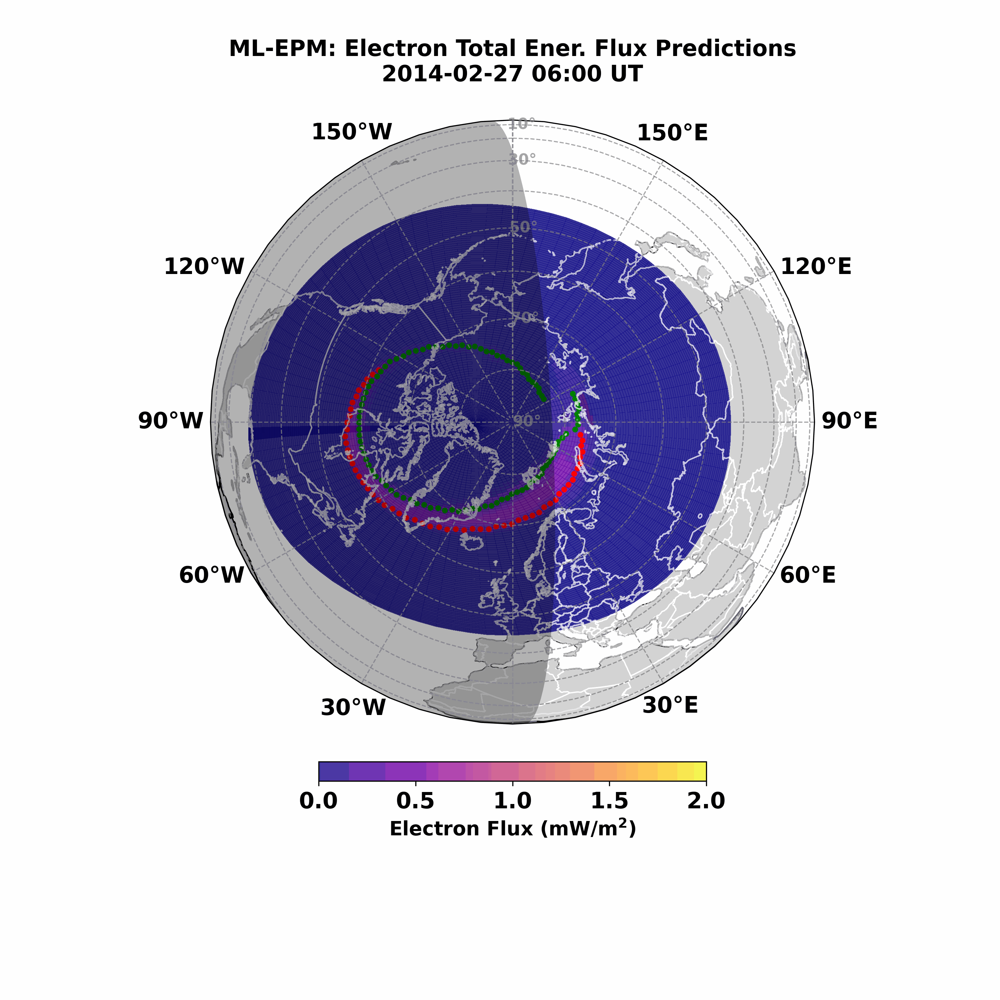

# Machine Learning-based Electron Precipitation Model (ML-EPM)

[](https://www.gnu.org/licenses/gpl-3.0)



This repository contains the Python code for the **Machine Learning-based Electron Precipitation Model (ML-EPM)**.

## Overview

The ML-EPM is a machine learning model trained on DMSP SSJ data from 1987-1988 and 2000-2012. It is designed to predict key characteristics of electron precipitation in the Earth's upper atmosphere, including:

* **Differential Energy Flux of Electrons**
* **Total Energy Flux**
* **Mean Energy of Electrons**

## Model Inputs

The ML-EPM utilizes a comprehensive set of input features derived from solar wind conditions, geomagnetic indices, and temporal and spatial information. These inputs include:

* **Spatial Information:** `SC_AACGM_LAT` (Spacecraft Altitude Adjusted Corrected Geomagnetic Latitude), `sin_SC_AACGM_LTIME`, `cos_SC_AACGM_LTIME` (Sine and Cosine of Spacecraft AACGM Local Time)
* **Temporal Information:** `sin_ut`, `cos_ut` (Sine and Cosine of Universal Time), `sin_doy`, `cos_doy` (Sine and Cosine of Day of Year), `StormTime`
* **Solar Indices:** `F107` (F10.7 solar radio flux)
* **Interplanetary Magnetic Field (IMF):** `Bz`, `By`, `Bx` (GSM components)
* **Solar Wind Parameters:** `vsw` (Solar wind speed), `psw` (Solar wind dynamic pressure)
* **Geomagnetic Indices:** `AU`, `AL`, `SymH`, `PC` (Polar Cap index)
* **Time History Features:** These include 6-hour time-histories of IMF, solar wind, and geomagnetic indices listed above.

## Model Outputs

The ML-EPM provides the following outputs:

* **Differential Energy Spectra of Electrons:** Predictions across multiple energy channels (30eV to 30keV).
* **Total Energy Flux:** The integrated energy flux of precipitating electrons.
* **Mean Energy:** The average energy of the precipitating electrons.

## Example Usage

The model is designed to be run with a specific datetime. The provided code includes an example of how to generate predictions:

```python
from datetime import datetime
from ml_epm import gen_spectrum_local , gen_global_data, plot_flux_map
time1 = datetime(2014,2,27,18,0,0)
# df, inputs, inputs_scaled, model = gen_spectrum_local(time1, 65, 0, m='ele') # Example for a specific location
df, inputs, inputs_scaled, model, mlt, mlat, predictions_ele = gen_global_data(time1, min_mlat = 40, max_mlat = 90, m='ele')
tef = predictions_ele['Total Energy Flux'].values
tef = np.reshape(tef, [50, 50])
fig = plot_flux_map(tef, time1, mlt, mlat)
